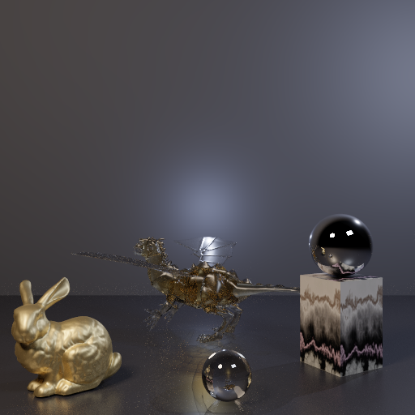
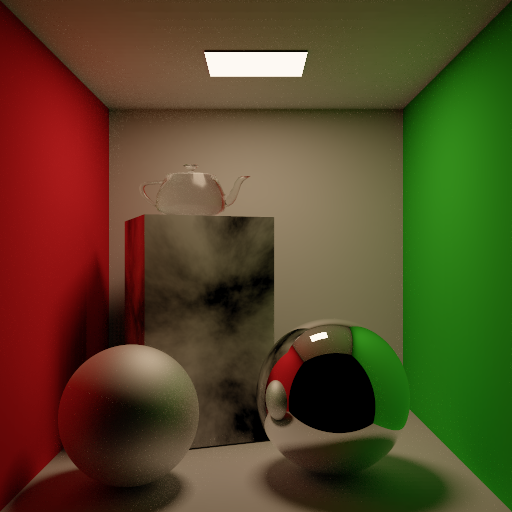
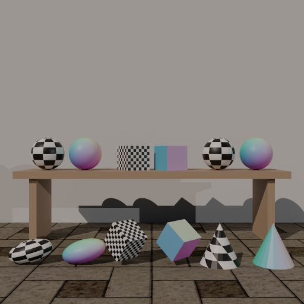
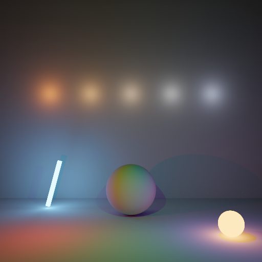
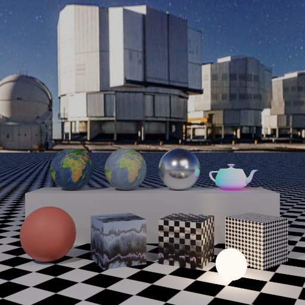
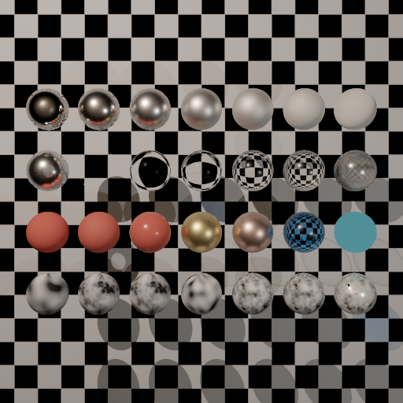
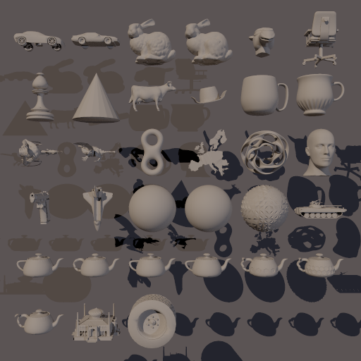
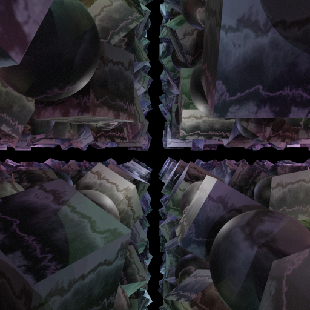

[](https://sonarcloud.io/dashboard?id=edu.schwabe.raytracer)
[](https://sonarcloud.io/dashboard?id=edu.schwabe.raytracer)
[](https://sonarcloud.io/dashboard?id=edu.schwabe.raytracer)

# edu.schwabe.raytracer

A spectral ray tracer in C++23, vectorized by hand with SSE 4.2, AVX2 and FMA intrinsics. It renders with hero
wavelengths, GGX microfacet materials, soft shadows of area lights, diffuse interreflection and a denoiser, and shows
the image in an interactive Windows UI (Win32 + OpenGL + Dear ImGui). Private hobby and learning project, licensed
under Creative Commons CC-BY-NC-SA.

|                                                                                           |                                                                                            |
|---------------------------------------------------------------------------------------------------------------------------------------|----------------------------------------------------------------------------------------------------------------------------------------------|
| **Showcase**: an amber glass dragon, a gold bunny, a chrome sphere on a marble pedestal and a diamond on black lacquer, lit by two softboxes | **Cornell box**: lit only by the box light in the ceiling and the light the walls throw back; mirror and rough mirror spheres, a glass teapot |

## Gallery

Every predefined scene, rendered at 512 x 512 with `--full-render` (3 x 3 samples per pixel, more where the pixels
are noisy).

|                                                                                                                                                               |                                                                                                                                        |
|-----------------------------------------------------------------------------------------------------------------------------------------------------------------------------------------------------|------------------------------------------------------------------------------------------------------------------------------------------------------------------------------------|
| **Forms** (`forms`): every form type (analytic and mesh sphere, ellipsoid, boxes, low-poly mesh, planes), each next to a twin whose color is its surface normal                              | **Lighting** (`lighting`): blackbody lights from 1900 K to 10000 K, CIE illuminant A and D65 as light pools; colored shadows of RGB lights; a sphere light and a glowing bar |
|                                                                                                                                                           |                                                                                                                              |
| **Shading** (`shading`): ESO's all-sky photo of Paranal as environment, sRGB vs. linear textures, normals as colors, texture transforms; hard shadows of a point light, soft ones of a softbox | **Materials & Noise** (`materials`): metal roughness from mirror to matte, every refraction index, plastics, gold, copper, tinted glass; Perlin and Simplex noise by octaves |
|                                                                                                                                                             |                                                                                                                                    |
| **Meshes** (`meshes`): every mesh of `data/meshes` in clay, under two directional lights                                                                                                      | **Procedural** (`procedural`): a stress test of 8000 spheres and boxes among 343 point lights                                                                               |

## Features

### Light transport

* **Spectral rendering** with hero wavelengths (Wilkie et al. 2014): RGB materials are upsampled with Smits' basis,
  lights can be blackbodies or CIE illuminants; the spectrum is converted to XYZ, sRGB and tone-mapped by AgX
* **Microfacet materials**: GGX highlights and glossy reflections, importance-sampled by the visible normals (Heitz
  2018); rough refraction (Walter et al. 2007); exact Fresnel equations for dielectrics, Schlick's for conductors;
  compensation of the multiple scattering between microfacets (Turquin 2019); a diffuse base coupled to the specular
  lobe above it (Kelemen and Szirmay-Kalos 2001); Beer-Lambert absorption in transparent media
* **Lights**: point, sphere and box lights (soft shadows; exact form factors), directional lights; the highlights of
  area lights on rough surfaces combine shadow rays and glossy rays by multiple importance sampling; shadows through
  glass
* **Global illumination**: one bounce of diffuse interreflection by cosine-weighted rays, interpolated from an
  irradiance cache (Ward et al. 1988, with Křivánek's neighbour clamping), and many-light sampling at the bounce
* **Clean images fast**: adaptive sampling of noisy pixels, and an edge-avoiding à-trous denoiser (Dammertz et al.
  2010, with SVGF's edge-stopping weights) guided by normals, depths and albedos for the interactive previews

### Performance

* **`vectorization`**: a SIMD library of its own over SSE 4.2, AVX, AVX2 and FMA (`v_f32_4`, `v_f32_8`, `v_i32_8`,
  `m_f32_4x4`, …), with an SSE 4.2 fallback for every AVX2 path
* **KD-trees** built by the surface area heuristic (sweep-based), stored as flat arrays and traversed eight children
  at a time: one SIMD test covers three tree levels, for the scene and for each mesh
* **Triangle tests** by Havel and Herout's method, in the mesh leaves for eight facets at once
* **OpenMP** over ray packets; rendering runs on a background thread, so the UI stays responsive, with fast previews
  while the camera moves

### Geometry and shaders

* Forms: sphere, box, plane and triangle meshes (OFF files), each with its texture mapping
* Seven material channels per object (diffusion, reflectance, specular, roughness, transmittance, refraction index,
  emittance), each driven by a shader: constants, PPM/HDR textures, Perlin and Simplex fractal noise, surface normals,
  and combinations of them
* Environment maps in five projections: fisheye dome, all-sky fisheye, mirror ball, angular map, latitude-longitude

## Getting started

### Prerequisites

* Windows 10/11 on an x64 CPU with AVX2
* Visual Studio with the C++ desktop workload (MSVC or clang-cl; developed with Visual Studio 2026)
* CMake 4.0 or newer and Ninja (both come with Visual Studio)
* [vcpkg](https://vcpkg.io/en/getting-started): set `VCPKG_DIR` to the directory containing `vcpkg.exe` and add it to
  `PATH`. vcpkg installs GLEW and Dear ImGui (declared in `vcpkg.json`)

### Data

Unpack `data/data.zip` into `data/`, so that it contains `meshes/` and `textures/`. See
[data/README.md](./data/README.md).

### Build

From a Visual Studio developer shell (`vcvars64.bat`):

```bash
cmake --preset release
cmake --build --preset release
```

| Preset          | Compiler | Build directory       |
|-----------------|----------|-----------------------|
| `debug`         | MSVC     | `build-debug`         |
| `release`       | MSVC     | `build-release`       |
| `clang-release` | clang-cl | `build-clang-release` |

Visual Studio and CLion open the folder as a CMake project and read the presets.

### Run

The executable needs `data/` as its working directory:

```bash
cd data
../build-release/sources/raytracerui/raytracerui.exe --scene=showcase
```

| Option                                                                 | Effect                                                                                                                           |
|------------------------------------------------------------------------|----------------------------------------------------------------------------------------------------------------------------------|
| `--scene=<id>`                                                         | start with a scene: `cornell-box` (default), `procedural`, `forms`, `lighting`, `shading`, `materials`, `meshes`, `showcase`     |
| `--full-render`                                                        | render the first image in full quality instead of as a fast preview                                                              |
| `--exit-after-render`                                                  | render without a window, save `ray-traced.png` and exit                                                                          |
| `--exposure=<stops>`                                                   | brighten or darken the image                                                                                                     |
| `--super-sampling=<n>`                                                 | (n+1) x (n+1) samples per pixel                                                                                                  |
| `--glossy-samples=0 --sphere-light-samples=0 --diffuse-samples=0`      | classic Whitted ray tracing: mirror reflections, hard shadows, no interreflection (much faster)                                  |
| `--denoise=<0\|1>`, `--irradiance-caching=<0\|1>`, `--seed=<n>`        | switch the previews' denoiser or the irradiance cache, or pick another sample pattern                                            |

The gallery's images come from `raytracerui.exe --scene=<id> --full-render --exit-after-render`.
[sources/raytracerui/CLAUDE.md](./sources/raytracerui/CLAUDE.md) lists every option.

### Test

The tests are MS CppUnitTest DLLs, run by Visual Studio's Test Explorer or `vstest.console.exe`:

```bash
vstest.console.exe build-release/tests/vectorization.native-test/vectorization.native-test.dll
vstest.console.exe build-release/tests/primitives.native-test/primitives.native-test.dll
vstest.console.exe build-release/tests/raytracing.native-test/raytracing.native-test.dll
```

## UI

Most parameters are exposed in ImGui panels. Toggle them with the function keys:

* **F1** — Controls reference
* **F2** — Metrics (timing, MRays/s, ray statistics, KD-tree info)
* **F3** — Configuration: sampling (trace depth, glossy, area light and diffuse rays, many-light picks, glossy clamp,
  super-sampling, adaptive rounds and threshold, denoising, irradiance caching), ray packet size, exposure, scene,
  culling, KD-tree balancers, fast preview, display mode (image / timing map / depth map), field of view, interaction
  mode, *Full Render*, *Save As* PNG/BMP
* **F4** — Log

### Mouse and movement

* **W / A / S / D** — move forward / left / back / right
* **Space / C** — move up / down
* **Right-mouse drag** — depends on interaction mode (set in F3 or via `1`/`2`/`3`):
    * `1` Camera — rotate view
    * `2` Object — translate last-added object on Z
    * `3` Light — translate last-added light on Z, with its emitter (an area light's glowing sphere or box)
* **Left-mouse drag** (Object mode only) — scale last-added object

### Keyboard shortcuts

* **Enter** — full-quality render (bypasses fast preview)
* **R** — reset camera
* **T** — toggle fast preview
* **E** — cycle display mode (image / timing map / depth map)
* **Q** — cycle culling orientation (back / none / front)
* **J / K** — decrease / increase super-sampling factor
* **G / H** — decrease / increase ray packet size

The first rendered frame is auto-saved to `ray-traced.png` in the working directory.

## System overview

Six targets in a layered dependency chain:

* **logging** — thread-safe logger with lazy message evaluation and a worker thread; backs the F4 log panel
* **vectorization** — the SIMD wrapper library (see Performance). Vectorized exp/log come from `sse_mathfun.h` /
  `avx_mathfun.h` (see Credits)
* **primitives** — ray-casting types with SIMD intersection tests: Ray, AABB, BoundingSphere, Facet, SplittingPlane,
  and the eight-facet block test
* **raytracing** — scenes, forms, KD-trees (several balancers and traversers), shading, lights, the spectral pipeline,
  irradiance cache, denoiser and PNG export via the Windows Imaging Component
* **raytracerui** — the Win32 + OpenGL frontend with the Dear ImGui overlay and the predefined scenes
* **benchmarks** — RDTSC micro-benchmarks of the intersection tests and of mesh traversal

Rendering runs on a background `std::jthread`; the UI thread triggers renders without blocking and receives
completion via `WM_RENDER_COMPLETE`. Scene mutations (e.g. KD-tree rebuilds) are serialized with rendering through an
enqueue-work pattern.

## Credits

Project scaffold: [The C++ CMake Project Template](https://github.com/cginternals/cmake-init).

Vectorized exp/log via [sse_mathfun.h](http://gruntthepeon.free.fr/ssemath/) and
[avx_mathfun.h](http://software-lisc.fbk.eu/avx_mathfun/).

UI overlay via [Dear ImGui](https://github.com/ocornut/imgui).

The Shading scene's environment is ESO's all-sky photo of the night over Paranal.
